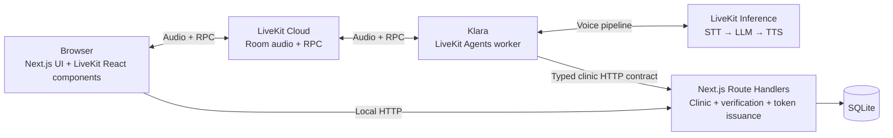

# ClinicLine

**A voice-first appointment assistant built with LiveKit Agents and Next.js.**

Meet **Klara**, a Polish- and English-speaking virtual receptionist. Patients can talk to her to find available appointments, book a visit, check existing reservations, cancel, or reschedule. When identification is needed, Klara opens a form in the browser instead of asking the caller to dictate a PESEL number.

ClinicLine is a simplified reservation system inspired by the Polish public health fund. It uses fictional clinics, doctors, and patients to explore real-time voice AI—not to provide healthcare services. ClinicLine is the application name, not the clinic's name.

The project focuses on a practical question: **how do you turn a voice conversation into a reliable, observable application action?**

## LiveKit in practice

| Capability                  | How ClinicLine uses it                                                                                                                                          |
| --------------------------- | --------------------------------------------------------------------------------------------------------------------------------------------------------------- |
| **Real-time audio**         | The browser and agent join a LiveKit room for a two-way voice conversation.                                                                                     |
| **Cascaded voice pipeline** | Separate STT, LLM, and TTS models make each stage easy to inspect and replace through LiveKit Inference.                                                        |
| **Turn handling**           | LiveKit turn detection, adaptive interruptions, and preemptive generation control conversational timing. The browser entrypoint also applies audio enhancement. |
| **Function tools**          | Typed tools connect Klara to clinic data and appointment operations. Tool descriptions explain when to act and how to handle failures.                          |
| **Frontend RPC**            | The agent requests a browser verification form. The browser acknowledges immediately and later notifies the agent when the verification status changes.         |
| **Explicit agent dispatch** | A server-issued room token dispatches the named `klara` worker with the call's room, participant, and language binding.                                         |
| **Session state**           | Each conversation owns its verification reference, pending proposal, and mutation receipts. An unrelated call cannot reuse them.                                |
| **Developer tooling**       | An isolated console/demo entrypoint, the LiveKit debugger, and agent simulations support experiments without the web app or database.                           |

The application uses **native function tools** for its clinic API. Calendar integration through MCP is not implemented.

## Experience

1. Select **Polish or English** and start a call.
2. Ask Klara for an appointment with one of the available doctors.
3. Provide a fictional first name and surname. Enter the fictional PESEL in the requested on-screen form.
4. Choose a slot. Klara reviews the doctor, date, time, and requested action.
5. Confirm in a subsequent response. Klara announces success only after the backend confirms the saved change.

Corrections replace the pending proposal and require a new review. A form submission is never treated as consent to book, cancel, or reschedule.

Klara stays within appointment assistance. She does not diagnose conditions, assess symptoms, or recommend treatment.

## Architecture

Two independent TypeScript applications keep the voice runtime easy to experiment with:



- **`webapp/`** owns the page, server-only clinic functions, SQLite persistence, call verification, and LiveKit token issuance. Browser components never access SQLite or server credentials.
- **`agent/`** owns model configuration, prompts, tool definitions, conversational state, and the RPC bridge. It depends on a small clinic contract, not the Next.js implementation.
- **Two clinic adapters** implement that contract: an HTTP client for browser calls and deterministic in-memory fixtures for standalone learning.

Local application traffic uses HTTP. Connections to LiveKit Cloud retain their normal secure transport. There is no separate API-server process.

### Reliable appointment changes

The agent separates **prepare**, **review**, and **commit**. It waits for the review's speech handle to finish, rejects interrupted reviews, and requires a later caller message before committing the current proposal. The model interprets the caller's response; application code enforces proposal identity and message ordering.

The backend revalidates patient access, scheduling rules, and availability inside SQLite write transactions. Cancellation and rescheduling compare the original appointment with the reviewed snapshot inside the transaction, so a stale proposal cannot silently change a different appointment state. Rescheduling preserves the appointment ID and doctor.

Completed proposal retries return a call-local receipt. If a write's outcome is unknown, further writes are blocked for that conversation rather than blindly retried. These receipts are not durable cross-call idempotency keys.

### Voice-to-form verification

PESEL is an eleven-digit Polish personal identifier. In this demo, it is entered as text:

```mermaid
sequenceDiagram
    participant K as Klara
    participant B as Browser
    participant S as Next.js server

    K->>S: Request call-bound verification
    S-->>K: Request ID + expiry
    K->>B: RPC: open form
    B-->>K: Immediate acknowledgement
    Note over B: Microphone muted; user enters fictional PESEL
    B->>S: Submit form over local HTTP
    S-->>B: Verification status
    B->>K: RPC: status changed, request ID only
    K->>S: Read authoritative verification result
    S-->>K: Status + opaque verification reference
```

The backend binds requests to the call and participant, expires them, and atomically consumes a successful submission. Appointment tools use an opaque reference rather than the raw identifier. Dismissal, expiry, supersession, and call cleanup revoke access. Verification state lives in SQLite across request handlers.

## Run locally

### Requirements

- Node.js **24+** and pnpm **10+**.
- LiveKit CLI **2.19+**; check installed command help if your version differs.
- A LiveKit Cloud project with Inference access.

From the repository root:

```sh
pnpm --dir webapp install --frozen-lockfile
pnpm --dir agent install --frozen-lockfile
```

For a fresh checkout, create local environment files:

```sh
cp webapp/.env.example webapp/.env.local
cp agent/.env.example agent/.env.local
```

Keep existing local environment files if they are already configured. In **both** files, set:

```dotenv
LIVEKIT_URL=wss://YOUR_PROJECT.livekit.cloud
LIVEKIT_API_KEY=YOUR_KEY
LIVEKIT_API_SECRET=YOUR_SECRET
CLINIC_AGENT_SECRET=THE_SAME_RANDOM_SECRET_IN_BOTH_APPS
```

Generate the shared agent-to-clinic secret with:

```sh
node -e 'console.log(require("node:crypto").randomBytes(32).toString("hex"))'
```

Credentials stay server-side. Never prefix them with `NEXT_PUBLIC_` or commit `.env.local` files. Use a dedicated learning project if you also have other LiveKit agents or real calls.

Start the two processes in separate terminals:

```sh
# Terminal 1: UI, HTTP endpoints, and SQLite
pnpm --dir webapp dev
```

```sh
# Terminal 2: local LiveKit worker
pnpm --dir agent dev
```

Open **[http://localhost:3000](http://localhost:3000)**, select a language, and allow microphone access. The agent's dev script registers the local worker against the `production` dispatch target used by browser tokens; it does not deploy the code.

SQLite initializes and seeds automatically. The seed provides two fictional doctors, ten patients, and thirty weekday appointments. Existing records are preserved; seed appointment dates are not refreshed on every start.

**New patients are welcome:** give Klara any fictional first and last name, then enter any 11-digit fictional PESEL only in the requested form. No checksum or existing-name match is required. The backend atomically creates a new patient for a new PESEL, or reuses the existing patient without overwriting their name. Klara acknowledges a new registration only after the backend confirms it. The form stays open for invalid formatting. Closing it restores the microphone if it was previously on; after successful submission, unmute explicitly.

### Configuration

| Setting                  | Application | Purpose                                                                       |
| ------------------------ | ----------- | ----------------------------------------------------------------------------- |
| `DATABASE_PATH`          | webapp      | SQLite file; defaults to `./data/clinic-line.sqlite` relative to the web app. |
| `CLINIC_API_URL`         | agent       | Clinic API base; defaults to `http://localhost:3000/api/`.                    |
| `DEMO_LANGUAGE`          | agent       | Standalone demo language: `en` or `pl`. Browser calls use the UI selection.   |
| `LLM_MODEL`              | agent       | LiveKit Inference language-model override.                                    |
| `STT_MODEL`              | agent       | Speech-recognition model override.                                            |
| `TTS_MODEL`, `TTS_VOICE` | agent       | Speech-synthesis model and compatible voice overrides.                        |

Model configuration is centralized in [`agent/src/models.ts`](agent/src/models.ts). Values in `.env.local` override the code defaults; the example environment file also supplies model choices. Check each model's language support and parameters before swapping providers. Restart the worker or debugger after changes.

## Experiment with the agent alone

The standalone entrypoint needs LiveKit model credentials, but **no Next.js process, SQLite database, browser form, or clinic secret**.

```sh
pnpm --dir agent console
```

It creates fresh in-memory state for each session, uses a fixed clock of **6 May 2030**, and offers fixture slots on **7–8 May**. Verification is explicitly simulated using `Pacjent1 Testowy`; `Alicja Nowa` exercises new-patient registration. No PESEL is collected. The browser entrypoint never falls back to this behavior.

Try a scripted conversation with the debugger:

```sh
cd agent
lk agent debugger start src/demo.ts --port 18978
lk agent debugger say --port 18978 "Book Maria Przykładowa on May 7, 2030 at 10:00 Warsaw time. My fictional name is Pacjent1 Testowy."
# Wait for Klara's review, then correct the proposal:
lk agent debugger say --port 18978 "Actually, make it eleven o'clock instead."
# Wait for the revised review, then approve:
lk agent debugger say --port 18978 "Yes, book that appointment."
lk agent debugger say --port 18978 "Look up my appointments."
lk agent debugger stop --port 18978
```

Useful experiments include comparing model response latency, changing tool descriptions, interrupting a review, correcting a proposed time, and inspecting the resulting tool calls. The cascaded pipeline provides a clear baseline for a later realtime-model comparison; switching architectures also requires revisiting turn handling, transcription, and diagnostics.

## Agent verification and diagnostics

**Deterministic agent tests** cover tool behavior, verification, later approval, interrupted reviews, corrections, isolation, duplicate commits, and uncertain outcomes:

```sh
pnpm --dir agent test
```

**Model-driven simulations** use only the isolated demo:

```sh
pnpm --dir agent simulate
```

The scenarios exercise booking, a corrected proposal, and Polish privacy behavior. Final-state checks inspect the saved appointment in addition to evaluating the conversation. Simulations consume LiveKit Inference usage.

Run static checks and builds from the repository root:

```sh
pnpm --dir webapp typecheck
pnpm --dir webapp lint
pnpm --dir webapp build
pnpm --dir agent typecheck
pnpm --dir agent lint
pnpm --dir agent build
```

The agent runs TypeScript directly; its build command performs type checking without emitting JavaScript. Dedicated frontend/backend test suites are intentionally outside the learning scope. CI is configured for both applications' checks, agent tests, and isolated simulations; cloud simulations require the configured LiveKit repository secrets. Prettier conventions are shared at the repository root.

The browser diagnostics display actual SDK connection and agent states, connection quality, reconnect counts, track counts, microphone state, elapsed time, and RPC activity. Per-stage STT/LLM/TTS timings are marked unavailable because the agent does not publish them to the UI. Text tests and simulations do not establish microphone permissions, speech quality, or real audio interruption behavior—those require a browser voice call.

## Scheduling scope

- Multiple doctors, with conflicts checked for both doctor and patient.
- `Europe/Warsaw` calendar rules, Monday–Friday, 07:00–19:00.
- Thirty-minute visits starting on the half hour and fitting entirely within opening hours.
- Future slots within today and the following twenty-nine calendar days; no holiday calendar.
- Cancellation and rescheduling only before the original appointment starts.
- `scheduled` and `cancelled` statuses; cancelled records remain stored and release availability.

## Project map

```text
agent/src/
  main.ts           Browser-call worker and RPC lifecycle
  demo.ts           Isolated console/debugger/simulation entrypoint
  models.ts         Voice pipeline and model configuration
  prompts.ts        Klara's role and conversational instructions
  tools.ts          Typed function tools and their descriptions
  conversation.ts   Proposal review, approval, commit, and receipts
  clinic.ts         Backend-independent clinic contract
  clinic-client.ts  HTTP implementation of that contract
  demo-clinic.ts    Deterministic in-memory implementation
  verification.ts   Browser-form RPC bridge

webapp/src/
  app/api/          Thin HTTP Route Handlers
  server/           Clinic rules, SQLite, verification, and tokens
  components/       Call UI, lifecycle hook, form, and diagnostics
```

## Boundaries

This is a local learning demo with fictional data, not an authenticated healthcare service or a compliance-certified system. It does not establish real patient identity or insurance eligibility. The form flow keeps application-submitted PESEL out of model/tool context; privacy does not depend on automated PII redaction. Anything spoken aloud can still reach speech providers.

Keep SQLite on persistent local storage and keep secrets out of the browser. Public hosting, real personal data, calendar synchronization, medical records, and durable cross-call mutation receipts are outside the current scope. Model wording can vary; explicit state and backend validation remain essential even with a carefully written prompt.

## LiveKit references

- [Voice pipeline types](https://docs.livekit.io/agents/models/pipelines/)
- [Function tools](https://docs.livekit.io/agents/logic/tools/definition/)
- [Forwarding tools to the frontend](https://docs.livekit.io/agents/logic/tools/forwarding/)
- [RPC between participants](https://docs.livekit.io/transport/data/rpc/)
- [Agent dispatch](https://docs.livekit.io/agents/server/agent-dispatch/)
- [Agent debugger](https://docs.livekit.io/testing/debugger/)
- [Agent simulations](https://docs.livekit.io/testing/simulations/)
